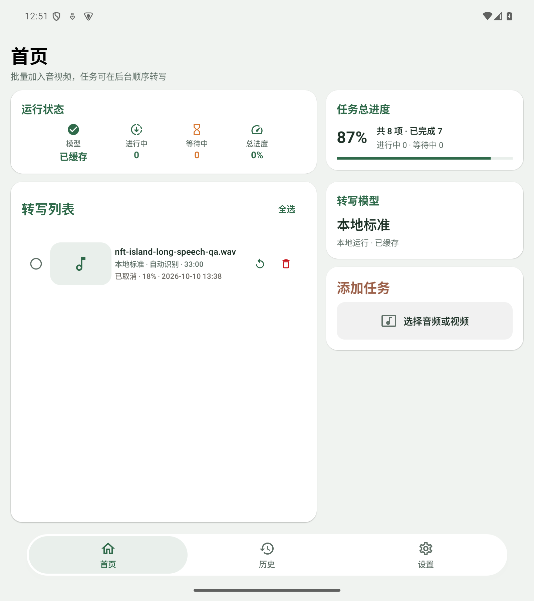
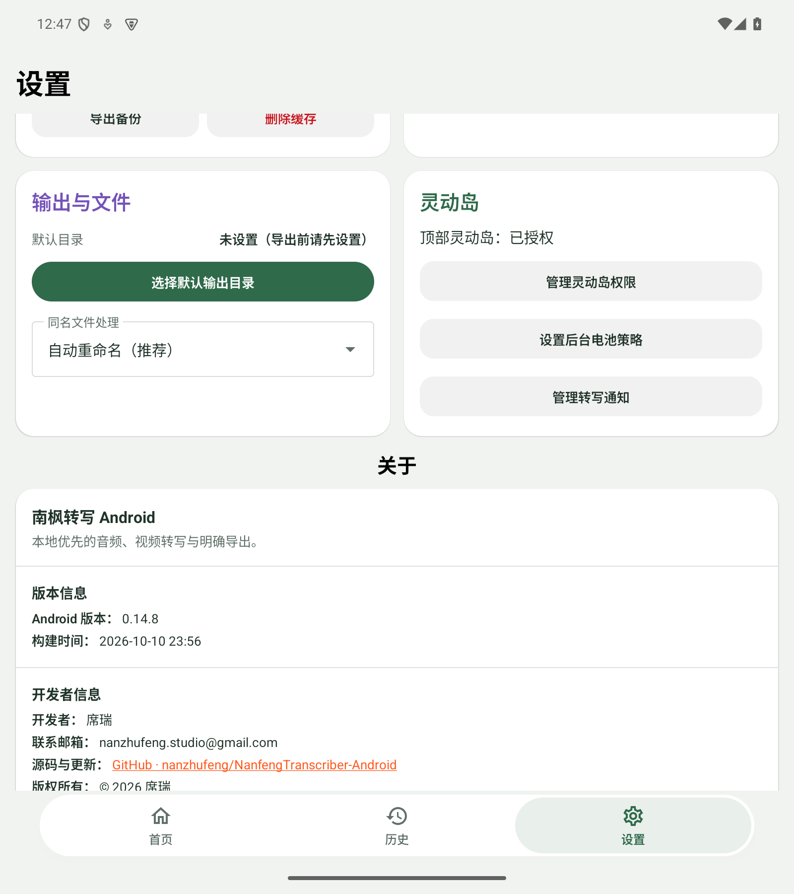

# 南枫转写 Android

音频、视频转写与明确导出。

维护入口：[合同唯一索引](docs/contracts-index.md)。当前能力与未验收边界见 [项目状态](docs/PROJECT_STATUS.md)，模型预设和接口测试不代表真实云端服务已验收。

## 下载

[下载正式版 v0.14.8](https://github.com/nanzhufeng/NanfengTranscriber-Android/releases/tag/v0.14.8)

安装包：`nanfeng-transcriber-android-v0.14.8.apk`（本地构建名：`南枫转写.apk`），正式同签名包可保数据覆盖升级。

## 功能

- 本地标准 SenseVoice、高精度 Qwen Audio 文件转写、低成本 Paraformer 三种模式。
- 后台顺序转写、已保存断点恢复；顶部灵动岛默认一行，点击展开详情。悬浮窗权限在设置“灵动岛”中管理。
- 按完整文件保存历史、调用记录与费用估算。
- 可编辑结果，支持 TXT、MD、SRT、DOCX 明确导出。

## 界面预览

API 35 隔离模拟器，展开视口 1600 × 1800 / 320dpi，v0.14.8。主页为本地测试语音的取消状态；不是主设备截图。

<table>
  <tr>
    <td align="center"> 主页</td>
    <td align="center"> 灵动岛设置与关于</td>
  </tr>
</table>
