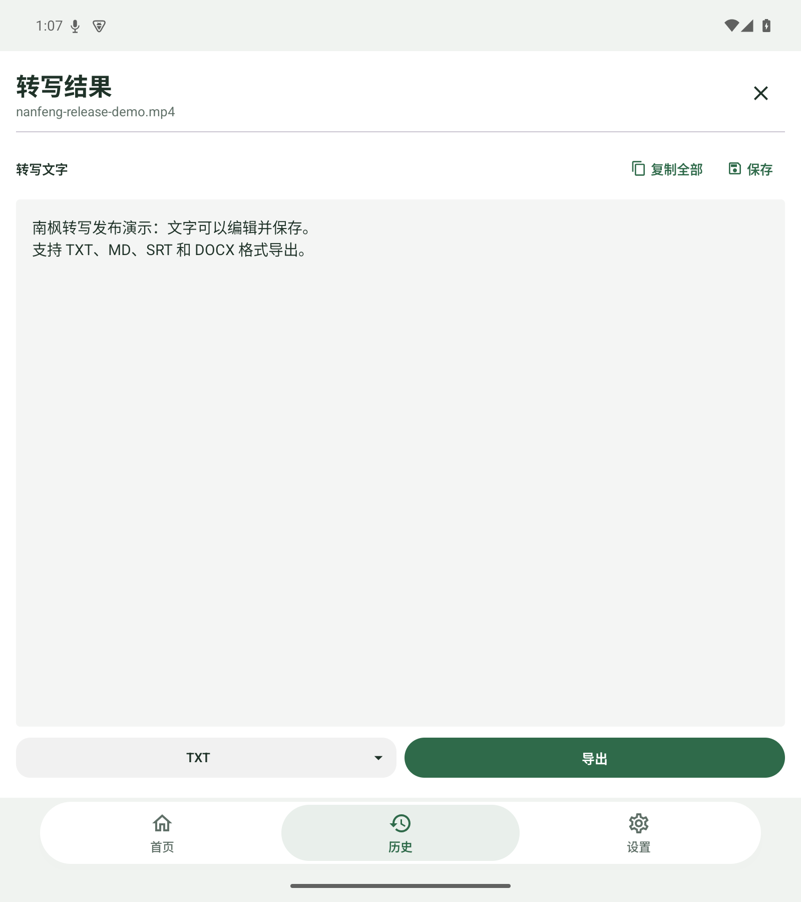
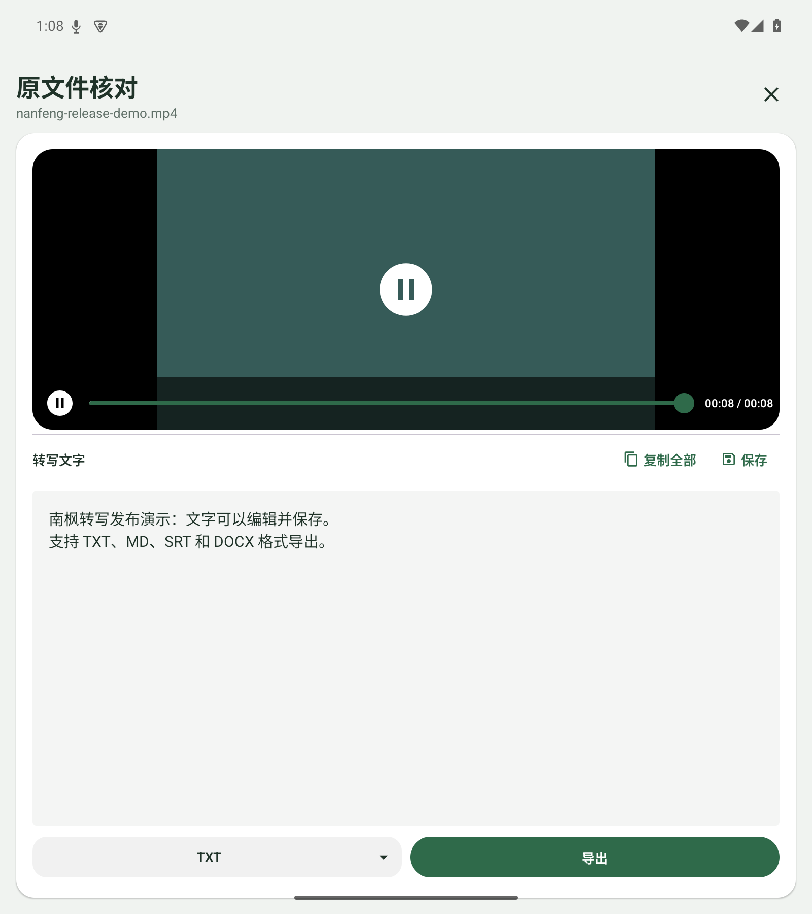

# 南枫转写 Android

音频、视频转写、正文保存与多格式导出。

维护入口：[合同唯一索引](docs/contracts-index.md)。当前能力与未验收边界见 [项目状态](docs/PROJECT_STATUS.md)，模型预设和接口测试不代表真实云端服务已验收。

## 下载

[下载已公开正式版 v0.14.8](https://github.com/nanzhufeng/NanfengTranscriber-Android/releases/tag/v0.14.8)

当前源码与下方预览为 v0.14.12；正式签名安装包上传中，尚未公开。上方链接仍为上一公开版本，不包含本轮保存、自动导出、关闭图标与Paraformer尾段修复；发布进度见[项目状态](docs/PROJECT_STATUS.md)。

## 功能

- 本地标准 SenseVoice、高精度 Qwen Audio 文件转写、低成本 Paraformer 三种模式。
- 后台顺序转写、已保存断点恢复；顶部灵动岛默认一行，点击展开详情。悬浮窗权限在设置“灵动岛”中管理。
- 按完整文件保存历史、调用记录与费用估算。
- 转写正文支持编辑并明确保存，新任务可按选定格式自动导出一次；支持 TXT、MD、SRT、DOCX 手动导出。

## 界面预览

API 35 独立隔离模拟器，展开视口1600 × 1800 / 320dpi，正式v0.14.12。输入为自造两段文字字幕演示视频，不是主设备/私人素材，也不是ASR准确率验证。

<table>
  <tr>
    <td align="center"> 转写结果</td>
    <td align="center"> 原文件核对</td>
  </tr>
</table>
